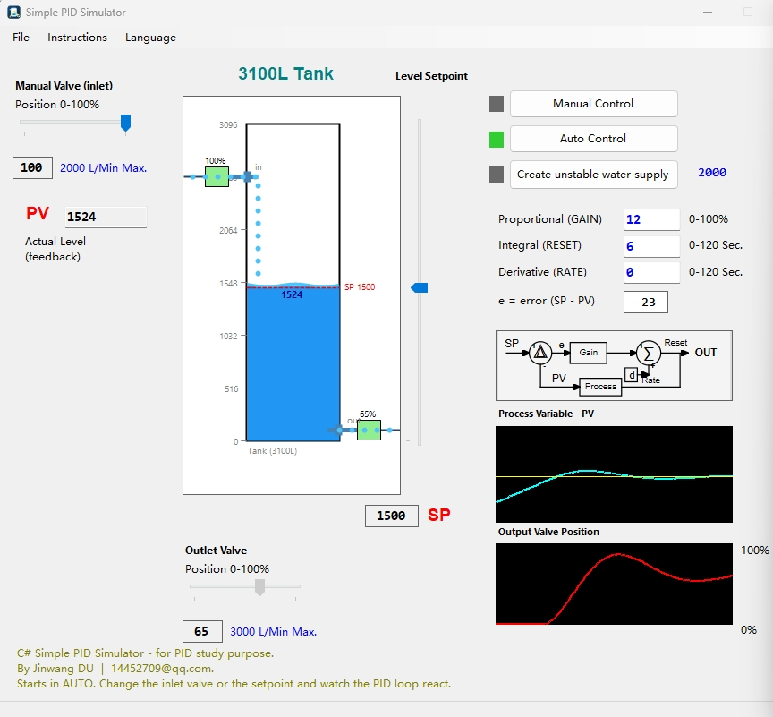

# PID_CSharp

**English** | [简体中文](README.zh-CN.md)

PID_CSharp is a C# WinForms simulator for water-tank level, oven temperature
and DC motor speed control. Change the setpoint and PID tuning, apply
disturbances, and watch the process and controller output respond. The
interface is available in English and Chinese.

The simulator is intended for learning PID control, practicing tuning and
comparing the responses of different processes.

Everyone is welcome to contribute code.

## Simulation scenarios

SP is the setpoint, PV is the measured process value, and MV is the controller
output. The controller adjusts MV based on the difference between SP and PV.

| Scenario | Setpoint and feedback | Controller output | Disturbances |
| --- | --- | --- | --- |
| Water tank | Target and actual water volume, L | Outlet-valve opening, 0–100% | Inlet-valve changes, unstable water supply |
| Oven | Target and measured temperature, °C | Applied heater output, 0–100% | Opening or closing the door, adding a cold workpiece |
| Motor | Target and actual shaft speed, rpm | Drive command, 0–100% | Applying or removing a 1.20 N·m load |

The tank controls its level by adjusting discharge: a high level calls for
more outlet-valve opening. In the oven and motor scenes, increasing the output
raises temperature or speed.

### Water-tank level

The tank has a capacity of 3,100 L. Its level display uses water volume in
liters. The inlet valve is adjusted manually; in automatic mode, the PID
controller adjusts the outlet valve. Change the inlet flow to observe the
valve response and the return toward the setpoint. Switch to manual mode to
adjust the outlet valve yourself and compare the two approaches.

### Oven temperature

The oven model includes the thermal inertia of the heater, chamber and
workpieces. Once the temperature has settled, add a cold workpiece or leave
the door open briefly before closing it. Watch how the heater output changes
as the temperature falls and recovers.

Opening the door cuts heater power immediately and increases heat loss
through air exchange. While the heater interlock is active, the controller
tracks the actual zero output. Closing the door releases the interlock and
resumes automatic control. The power readout and output trend show the applied
heater output.

### Motor speed

The 48 V DC motor model simulates armature current and electromagnetic torque,
with rotor inertia and a current limit. Applying load initially reduces the
speed, followed by an increase in drive output and current. Removing the load
initially raises the speed; the controller then brings it back toward the
setpoint.

The drive is unipolar. With a target of 0 rpm, the motor coasts down under
friction, without reverse braking current.

## Tuning and response curves

Start with the default settings:

| Scenario | Mode | Setpoint | Tuning |
| --- | --- | --- | --- |
| Water tank | PI | 1500 L | GAIN=12, RESET=6 s, RATE=0 s |
| Oven | PID | 180 °C | Kp=2.4 %/°C, Ti=20 s, Td=8 s |
| Motor | PI | 1800 rpm | Kp=0.1 %/rpm, Ti=0.3 s |

The tank uses GAIN, RESET and RATE for its tuning parameters. GAIN/100 is the
proportional gain in percentage points of valve opening per liter of error.
RESET is the integral time Ti, and RATE is the derivative time Td.

The motor interface retains Td=0.03 s. It is inactive in PI mode and becomes
active when PID mode is selected.

The oven and motor defaults produce some overshoot, so you can observe the
initial rise, the peak and the return to the setpoint. When comparing P, PI
and PID in these two scenes, click **Reset** after changing the mode to start
from the same initial conditions. Once the process settles, change the
setpoint or apply a disturbance. Adding derivative action does not guarantee
a better response with the existing tuning; retune and compare.

The tank runs at 10× simulation speed, the oven at 8× and the motor at 1×.
Ti, Td and trend times use simulated seconds. The **Instructions** dialog
provides operating steps and suggested experiments for all three scenes.

## PID controller and code structure

All three scenes use the algorithm in
[`PID_helper.cs`](pid_loop_CSharp/PID_helper.cs). Each has its own controller
instance and simulation state. Scene code handles units, control direction
and process models.

The controller supports P, PI and PID, with output limits, independent
integral limits, optional measurement filtering, filtered derivative on the
measurement, manual output tracking and online retuning. Anti-windup options
are conditional integration (the default), back-calculation and disabled
output-saturation feedback. Advanced options are configured through the
helper API; the interface has no anti-windup strategy selector.

The anti-windup design follows concepts from
[ROS control_toolbox](https://github.com/ros-controls/control_toolbox).
This is an independent C# implementation with no ROS dependency. See
[`PID_CONTROL.md`](PID_CONTROL.md) for equations, parameter conventions
and limitations.

The main form, `frmMain`, hosts three tabs. Each scene is a separate
UserControl: `usWaterTank`, `usOven` and `usMotor`. Page controls are declared
in their `.Designer.cs` files, so layouts can be edited in the Visual Studio
Designer.

## Build and run

Development requirements:

- Windows 10 or Windows 11.
- .NET SDK 9.0.315, pinned in `global.json`.
- .NET 8 Windows Desktop Runtime to run the application.
- Optional: Visual Studio 2022 17.14 or later with the
  **.NET desktop development** workload installed.

The application targets `net8.0-windows`. From the repository root, run:

```powershell
dotnet restore .\pid_loop_CSharp.sln
dotnet build .\pid_loop_CSharp.sln -c Release --no-restore
dotnet run --project .\pid_loop_CSharp\pid_loop_CSharp.csproj -c Release --no-build
```

You can also open `pid_loop_CSharp.sln` in Visual Studio, set the main project
as the startup project and run it.

The build copies `pid_loop.cfg`, `pid_sampling.cfg` and the PID diagram to
the output directory. Keep these files with the application when copying it
to another location. The sampling settings in `pid_sampling.cfg` apply to
the tank scene. The real I/O period setting is reserved for future integration
and does not enable hardware communication.

## Regression checks

The regression project is a standalone console runner that uses the shared
PID and process-model source files directly. It currently contains 76 checks
covering all three scenes, saturation recovery, filtering, output tracking,
parameter validation and the oven door interlock.

Run it from the repository root:

```powershell
dotnet run --project .\tests\PidLoop.RegressionTests\PidLoop.RegressionTests.csproj -c Release
```

This project is not included in the main solution and must be run separately.

## Scope

The process models and default settings are intended for teaching and
simulation experiments. The oven uses effective heat capacities and a fixed
airflow when the door is open. The motor model is also simplified. The curves
should not be treated as predictions for a particular machine.

The project has no hardware I/O integration and has not been validated on real
equipment. Using the controller with real equipment requires tuning for the
actual sampling period, sensors and actuators. You will also need I/O drivers,
data quality checks, watchdogs, actuator feedback and independent equipment
protection.

## Screenshot and historical versions

The image below shows an earlier water-tank interface. The current source
contains all three scenes. Archives in [`appDownload/`](appDownload/) are
historical versions; build from source for the current application.


